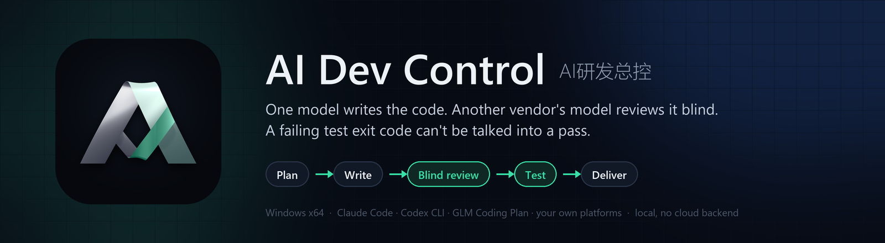
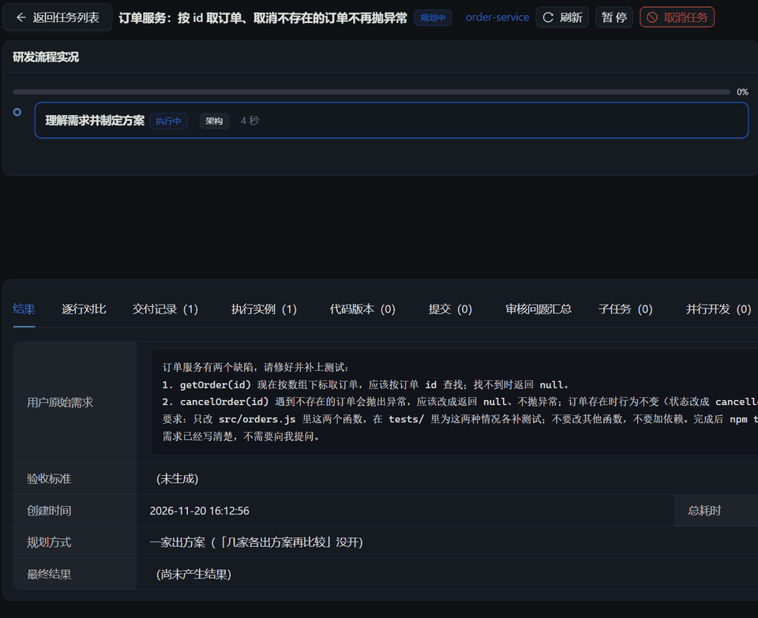
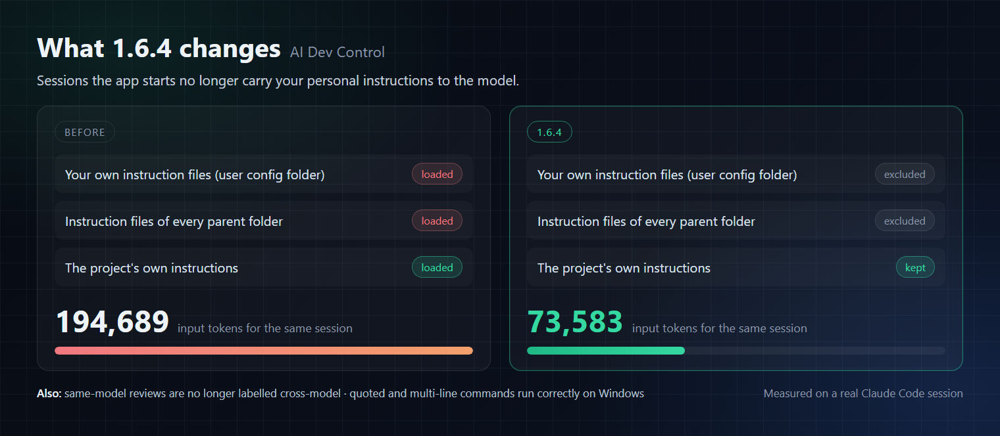
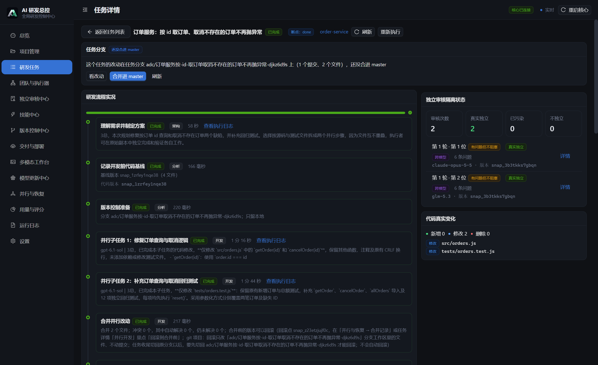
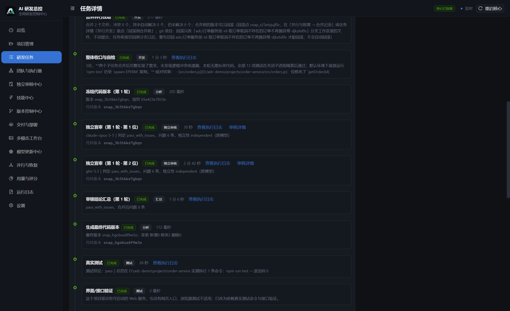
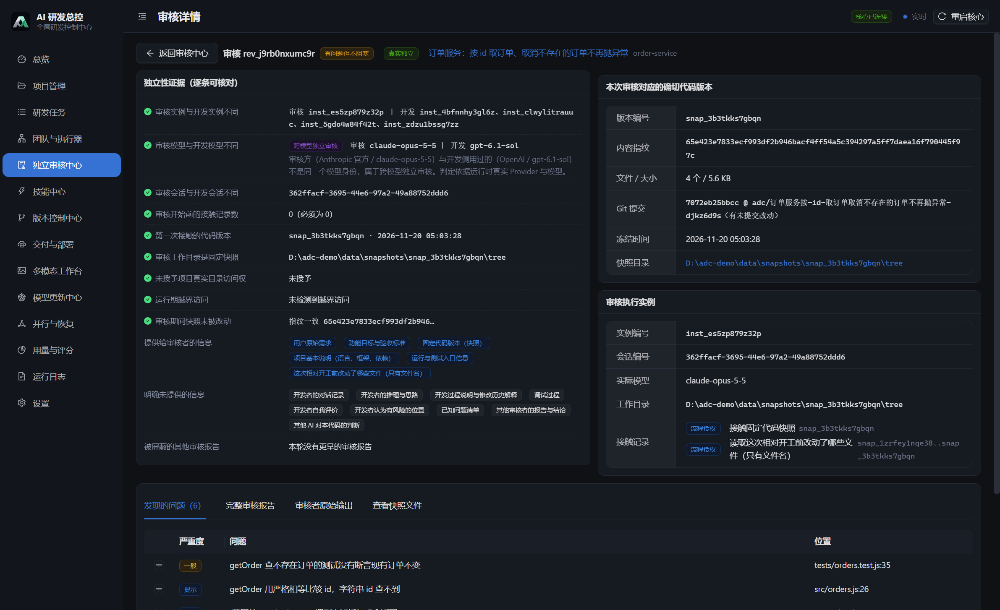
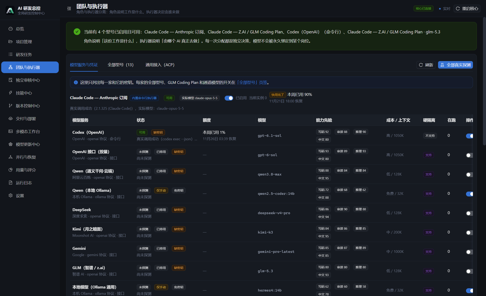

<p align="center"></p>

<p align="center"><b>English</b> · <a href="README.zh-CN.md">简体中文</a></p>

Several AI coding assistants working on your project together, on your own Windows PC. One model writes the code; a model from a different vendor reviews it blind, without seeing how it was written. The app runs the tests itself, and no model can talk a failing exit code into a pass.

<p align="center"><b>Windows x64 · v1.6.4 · UI: Simplified Chinese · installer only, source not public</b><br><a href="https://github.com/Eginn-33/ai-dev-control/releases/latest">Download the latest installer →</a></p>

<p align="center"></p>

<p align="center"><sub>A real task recorded on 1.6.2 (demo project, subscriptions only). Claude (claude-opus-5-5) plans and writes the fix, the code is frozen into a fingerprinted snapshot, GLM (glm-5.3) reviews it blind, then the app runs the tests itself. The task ends on its own branch; merging is your call.</sub></p>

## Why

When a single AI writes the code and then tells you it's done, the only evidence you have is that AI's own word. It wrote the code, and it graded it.

AI Dev Control is built on two rules:

- **Someone else checks.** Review goes to a model from another family, in a brand-new session, looking only at a frozen copy of the code. It doesn't see the developer's reasoning, and it doesn't see the other reviewer's report.
- **Measured beats claimed.** The app runs your project's test command itself and goes by the exit code. A model can never turn a failing exit code into a pass. If the exit code passes but the model reports a failure, the stricter verdict (fail) stands, and both are recorded.

## How a task runs

<p align="center"></p>

<details><summary>Text version</summary>

```text
You describe the task
  │
  ▼
Plan
  ▼
Develop ........ subtasks in separate working copies, models from different
                 vendors, then a three-way merge
  ▼
Freeze ......... snapshot with a SHA-256 fingerprint per file
  ▼
Blind review ... fresh session, another vendor, sees only the snapshot
  │   ├─ blocking issues ─────────► Fix ─► new snapshot ─► review again
  │   └─ fixer and reviewer still disagree ─► third-party arbitration
  ▼   (passed)
Tests .......... run by the app itself; a model cannot overrule a failing
                 exit code; real browser check for web projects
  ▼
Security ....... a model reads the code + deterministic scanners
  ▼
Deliver ........ on a task branch
```

</details>

- A reviewer never comes from the same vendor family as the developer. If that leaves nobody, it first tries another model from the same vendor, and only then a fresh instance of the same model, and it labels the review for what it is instead of calling it cross-model independent.
- If a working model is missing a key fact, the task stops and asks you (see *Question bridge* below).
- Every stage writes a checkpoint, so a crash or a reboot resumes from the last finished stage.

## Features

### Several models, one project

- **Parallel development across vendors.** A task can be split into subtasks. Each subtask gets its own full working copy and its own model, they run at the same time, and the results are three-way merged. A real conflict is never written into your code as a `<<<<<<<` half-file; it goes to a model as three versions (base / main / copy) to resolve.
- **Vendor spread on purpose.** Assignment tries to put subtasks on different model families, and holds back families that haven't touched the code so they can review it. In one real run, 3 vendors and 4 models did the development, and both reviewers came from two other vendors.
- **Capability levels, tested rather than assumed.** Every model is tested step by step: can chat → can call tools → can read and write files → can run commands → qualified to be an independent reviewer. If a level fails, the model stops at that level, and work that needs a higher level is not assigned to it.
- **New models onboard themselves.** The app checks each vendor's model catalog on a schedule. A new model gets probed and capability-tested first, and only then joins the rotation.

### Review you can audit

- **Independent blind review.** The reviewer is a new instance in a new session, working on a frozen snapshot directory, not your real project folder. It gets no developer reasoning and no other reviewer's report. The snapshot fingerprint is checked before and after the review, so you know the code didn't change underneath it.
- **Independence proof.** Every review comes with a list of exactly what the reviewer was given and what was withheld.
- **Fix loop and arbitration.** Issues above the threshold go to a fix, the fix produces a new snapshot, and a fresh reviewer looks again. If the fixer and the reviewer still disagree, a third-party model rules on each disputed issue.
- **Scope-aware.** Problems that were already in your code and are outside what you asked for still get reported, but they're labelled out-of-scope and don't hold the task up.

### Measured, not claimed

- **Tests go by exit code.** The app runs the project's test command itself. A model's summary can't make a failing run pass; it can only make the verdict stricter.
- **Real browser for web projects.** A web project gets started for real and opened in a real browser, using the optional GStack browser. If GStack isn't installed, the check is recorded as "unknown" and the task carries on.
- **Security check plus deterministic scans.** On top of a model reading the code for security problems, scanners that don't depend on any model look for vulnerable dependencies, leaked secrets, dangerous configuration and license issues.

### It works with you, not around you

- **Question bridge.** When a working model is missing something it can't guess, it stops and asks. The task shows as "waiting for your answer"; you reply in the app and it resumes from its checkpoint. Your answer is passed to every later step, reviewers included. Reviewers themselves aren't allowed to ask questions.
- **Quota awareness.** The app reads usage-limit signals from subscriptions such as Claude Code and the Codex CLI. When one model hits its limit, the work is reassigned and rerun, and that model's track record isn't penalised for it. If every vendor is out, the task pauses and picks up again by itself when the limit resets.
- **Subscriptions first.** You can use subscriptions you already pay for: Claude Code (Anthropic), the Codex CLI (ChatGPT), and GLM Coding Plan (run through Claude Code). Pay-as-you-go API keys work too. The author's own setup uses subscriptions only, with every pay-as-you-go API turned off.
- **Bring your own platform.** Add any OpenAI-compatible, Anthropic, Gemini or Ollama endpoint with your own key, tick the models you want, and they join the rotation once probing passes. A platform you add at a local address is always manual-only and never reviews. The built-in Ollama executors are not manual-only out of the box; you can put them on the manual-only list in Settings (the author's setup does), and then they're used only when you pick them.
- **ACP agents.** Supports the Agent Client Protocol (v1). The app can find coding tools on your machine that speak ACP and connect them in one click. ACP agents don't act as reviewers.

### Careful with your repository

- **Task branches.** Work happens on a separate task branch. Uncommitted changes you already had are stashed and handed back when the task finishes. If a task fails or is cancelled halfway, the work in progress is saved as a local commit and you're switched back to your original branch.
- **Crash recovery.** A checkpoint is written after each stage. After a crash, finished stages aren't redone. If automatic recovery has run more than 3 times in a row and the task still isn't done, it stops and waits for a person instead of burning quota.
- **Self-repair (author's machine).** On the author's development machine, where the app's own source lives, a failed task can be turned into a job to fix AI Dev Control itself. It goes through the same develop → blind review → test path and stops on a task branch for a human to confirm. Installed copies without the source don't show this button.

### Local by design

<p align="center"></p>

- Everything runs on your PC. API keys are encrypted with Windows DPAPI; the database stores a reference to them (plus a masked first/last few characters for display), never the key itself.
- The local API only answers on 127.0.0.1, and its access token is regenerated on every start.
- The data folder's permissions are narrowed to the current Windows user (plus SYSTEM and Administrators).
- Sessions the app starts don't carry your personal instructions to the model (since 1.6.4). Claude Code sessions leave out the instruction files in your user config folder and in every parent folder of the working directory; Codex sessions don't read `AGENTS.md` from parent folders. The instructions in the project's own folder are still loaded.
- The app goes online to reach the AI services you configure, plus public pages it watches: vendor model catalogs, release notes and status pages, and the npm / GitHub release feeds of the CLI tools it drives (to notice new models and new tool versions). If you set up a git remote or a delivery target for a project, it talks to that as well. For Node projects the security scan runs `npm audit`, which sends the dependency list to the npm registry. And the code and prompts of each task go to whichever AI services do the work.

## Screenshots

All four come from one real task in the installed app, taken in a clean demo data folder on 1.6.0 (these screens are unchanged in 1.6.1 through 1.6.4). The Codex CLI (gpt-6.1-sol) planned it and wrote it as two parallel subtasks; Claude (claude-opus-5-5) and GLM (glm-5.3) reviewed it blind. The interface is Simplified Chinese. Click a picture for full size.

<table>
<tr>
<td width="50%" valign="top"><a href="docs/screenshots/task-detail.png"></a><br><sub><b>Task detail.</b> The plan, two parallel subtasks written by gpt-6.1-sol, the merge, and on the right two blind reviews (claude-opus-5-5 and glm-5.3), both marked independent and cross-model.</sub></td>
<td width="50%" valign="top"><a href="docs/screenshots/task-review-and-tests.png"></a><br><sub><b>Review and tests.</b> Two blind reviews on the same frozen snapshot, the merged review summary, then the app running <code>npm run test</code> itself: exit code 0.</sub></td>
</tr>
<tr>
<td width="50%" valign="top"><a href="docs/screenshots/review-detail.png"></a><br><sub><b>Independence proof.</b> Different instance, session and model; zero prior contact; only the frozen snapshot; snapshot fingerprint unchanged during the review; plus what the reviewer was given and what it was never shown.</sub></td>
<td width="50%" valign="top"><a href="docs/screenshots/team.png"></a><br><sub><b>Team &amp; executors.</b> Subscriptions show live quota read from the provider; API providers stay switched off until you add a key; local models are manual-only.</sub></td>
</tr>
</table>

## Works with

| Kind | What it is | What you need | Can it be a blind reviewer? |
| --- | --- | --- | --- |
| Subscription, via CLI | Claude Code (Anthropic subscription) | Claude Code CLI installed and signed in | Yes, once it passes the isolation test |
| Subscription, via CLI | GLM Coding Plan (runs through Claude Code) | Claude Code CLI plus a GLM Coding Plan key | Yes, once it passes the isolation test |
| Subscription, via CLI | Codex CLI (ChatGPT subscription) | Codex CLI installed and signed in | No. In CLI mode individual tool calls can't be intercepted, so there's no hard folder isolation |
| API key | Built-ins such as OpenAI, DeepSeek, Gemini, Qwen, Kimi, GLM; or any OpenAI-compatible / Anthropic / Gemini endpoint you add | An API key for that service | Yes, once it passes the isolation test |
| Local models | Ollama | Ollama installed, models pulled | Only after passing the isolation test; can be put on the manual-only list in Settings |
| ACP agents | Coding tools that speak Agent Client Protocol v1 | The tool installed on your machine | No |

Gemini only works through an API key at the moment; see *Known limitations*.

## How it's tested

- **Full offline suite:** 86 test files, 2,237 test cases. 2,236 passed, 1 skipped (a slow case that needs a special environment variable), 0 failed. Three TypeScript builds, 0 errors.
- **On a real machine, using the installed build:** a UI crawl across 15 pages and their tabs (93 requests, 0 failed, 0 console errors); pause / resume / cancel drills; an install drill set up like a fresh computer.
- **Deterministic test bench:** a local fake model drives 6 scenarios: quota exhausted, a reviewer handing in an empty review, a credential lookup timing out, a new model being onboarded, a rerun after a question, and the scope brake. Real model calls: 0.
- **With real models:** the app fixing its own code, having several vendors each draft a plan and comparing the plans, session resume, and a capability test for each model.
- **Release gate:** one command, `verify-done`, runs 5 gates: no open items left on the requirements ledger (62 done; the rest recorded as decided against, out of scope, needing outside conditions, or not triggerable on a real machine), each done item's own check re-run from scratch, the full suite, the installed build matching the code file for file, and fresh real-machine evidence. A version isn't done until it exits with 0.

**Not yet verified:** Windows 10. The portable build (it has the same app inside as the installer, but wasn't tested on its own). Memory requirements haven't been measured.

## Install

1. Open [the latest release](https://github.com/Eginn-33/ai-dev-control/releases/latest).
2. Download one of:
   - `AI-Dev-Control-Setup-1.6.4-x64.exe`: the installer. Installs for the current user only, no administrator rights needed.
   - `AI-Dev-Control-Portable-1.6.4-x64.exe`: the portable version. No installation, just run it.
3. Check the file against `SHA256SUMS.txt` from the same release:

   ```powershell
   Get-FileHash .\AI-Dev-Control-Setup-1.6.4-x64.exe -Algorithm SHA256
   ```

   The hash it prints (in upper case) should match the line for that file in `SHA256SUMS.txt` (in lower case).
4. The installer isn't code-signed, so Windows SmartScreen will warn you. Click **More info**, then **Run anyway**.

The download is about 96 MB and includes its own runtime, so you don't need to install Node.js. The installer and the app are both in Simplified Chinese.

## Requirements

- Windows 11 x64. Windows 10 x64 hasn't been tested.
- Git, recommended. Task branches, stashing and rollback need the project to be a git repository.
- At least one working AI executor: for example a signed-in Claude Code CLI or Codex CLI, or an API key.
- Optional: Ollama for local models; GStack for the browser check on web projects.

## Known limitations

- Windows x64 only.
- The interface is Simplified Chinese only.
- The installer isn't code-signed, so SmartScreen warns on first run.
- A personal Gemini subscription can't be connected. Google has stopped letting the Gemini CLI use Gemini Code Assist for individuals; the server's answer is "This client is no longer supported for Gemini Code Assist for individuals". Gemini works through an API key only.
- Nothing gets assigned until at least one AI executor works (a signed-in Claude Code CLI or Codex CLI, or an API key).
- The Codex CLI and Gemini CLI in CLI mode, and ACP agents, can write code but never act as blind reviewers, because the app can't enforce folder isolation on them.
- Codex CLI 0.169.0 has no switch to leave out your user-level `~/.codex/AGENTS.md` and skill list. They stay in the context of Codex sessions; the app only tells the model at the top of the prompt not to follow them.
- Not tested on Windows 10.
- The source code is not public.

## FAQ

**Is it open source?**
No. The source is not public and all rights are reserved. The installers on the Releases page are free to download and try.

**Does it cost anything?**
The app is free to download and try. Model usage is billed by each AI vendor under your own subscription or API account.

**Where does my data go?**
The app's own data stays on your PC; the code and prompts of each task go to the AI services you use. By default the app keeps its data in `%LOCALAPPDATA%\AI研发总控\data`, with folder permissions narrowed to your Windows user, and API keys encrypted with DPAPI. Your projects stay where they are; the app doesn't move them. It goes online only for the services described under *Local by design*.

**Why is the interface only in Chinese?**
It was built first for the author's own workflow.

**Where do I report a bug?**
[GitHub Issues](https://github.com/Eginn-33/ai-dev-control/issues) on this repository.

## License

Proprietary. Source not public, all rights reserved. The released installers are free to download and try. See [LICENSE](LICENSE). Third-party components keep their own licenses: from 1.6.1 on, `THIRD-PARTY-NOTICES.txt` ships in the installation directory and is attached to each release.

## Author

Elias (Eginn) Chen · [github.com/Eginn-33](https://github.com/Eginn-33)
