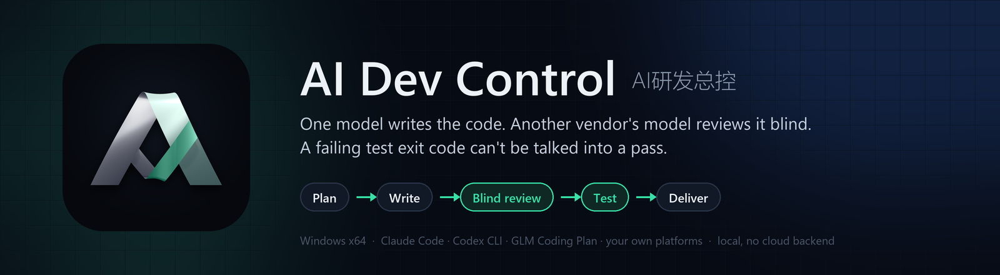
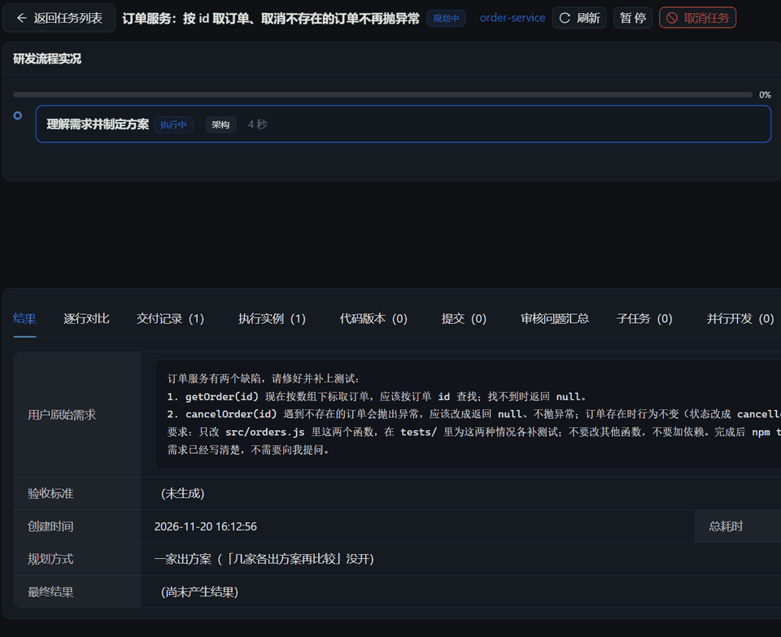
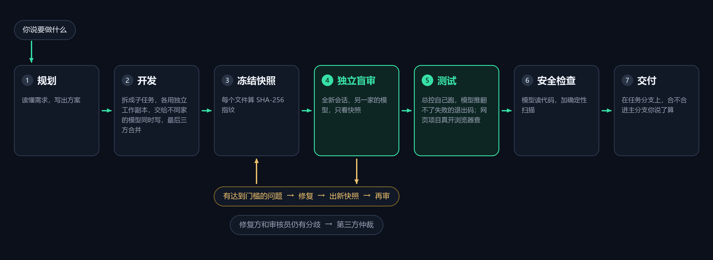
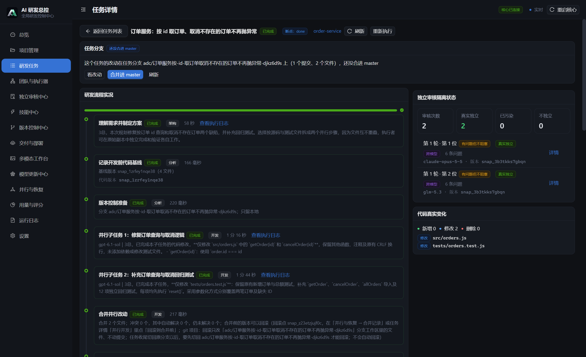
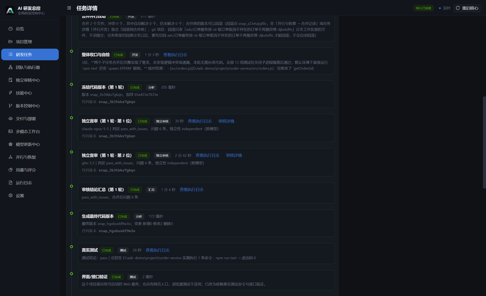
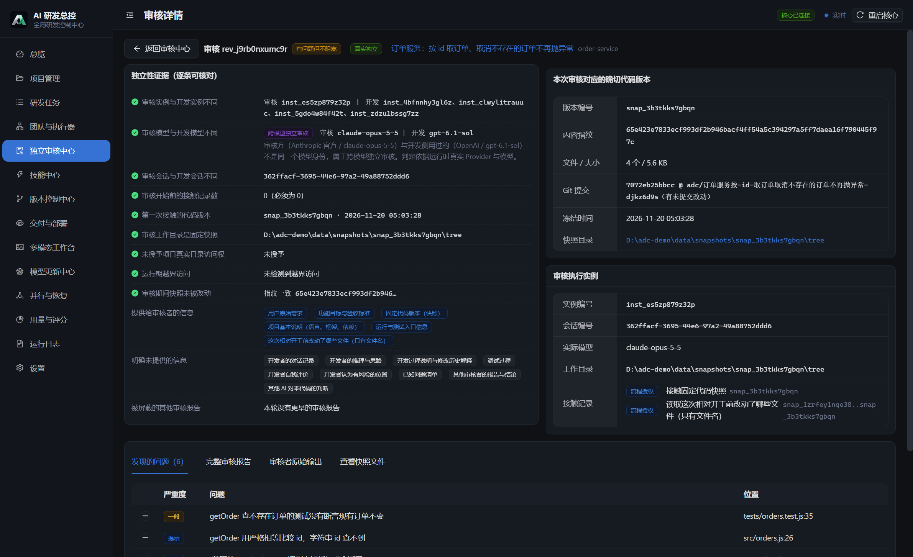
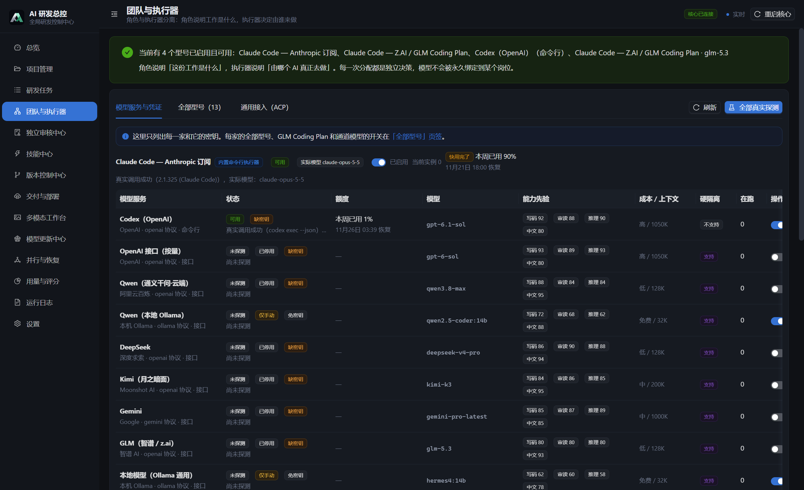

<p align="center"></p>

<p align="center"><a href="README.md">English</a> · <b>简体中文</b></p>

在你自己的 Windows 电脑上，让几家 AI 编程助手一起给你的项目干活。一个模型写代码，另一家的模型在看不到开发过程的情况下独立审核。测试由总控自己跑，失败的退出码哪个模型也说不成通过。

<p align="center"><b>Windows x64 · v1.6.3 · 界面：简体中文 · 只发安装包，源码不公开</b><br><a href="https://github.com/Eginn-33/ai-dev-control/releases/latest">下载最新安装包 →</a></p>

<p align="center"></p>

<p align="center"><sub>在 1.6.2 上录的一个真实任务（演示项目，只用订阅）。Claude（claude-opus-5-5）做规划、写修复，代码冻结成带指纹的快照，GLM（glm-5.3）盲审，然后总控自己跑测试。任务最后停在自己的分支上，合不合进主分支你说了算。</sub></p>

## 为什么做这个

一个 AI 写完代码、自己说「做完了」，你手里唯一的证据就是它自己这句话。代码是它写的，分也是它打的。

所以总控只认两条：

- **换人来查。** 审核交给另一家的模型，开一个全新会话，只看冻结下来的那份代码。开发者怎么想的它看不到，另一位审核员写了什么它也看不到。
- **实测说了算。** 总控自己去跑项目的测试命令，按退出码判。模型没法把失败的退出码说成通过；退出码过了、模型却报失败时，按更严的那个（失败）算，两边都记下来。

## 一个任务怎么跑

<p align="center"></p>

<details><summary>文字版</summary>

```text
你说要做什么
  │
  ▼
规划
  ▼
开发 ……… 拆成子任务，各在独立工作副本里，交给不同家的模型同时写，最后三方合并
  ▼
冻结快照 … 每个文件算 SHA-256 指纹
  ▼
独立盲审 … 全新会话、另一家的模型，只看快照
  │   ├─ 有达到门槛的问题 ──► 修复 ─► 出新快照 ─► 再审
  │   └─ 修复方和审核员仍有分歧 ─► 第三方仲裁
  ▼   （通过）
测试 ……… 总控自己跑，模型推翻不了失败的退出码；网页项目再真开浏览器查
  ▼
安全检查 … 模型读代码 + 确定性扫描
  ▼
交付 ……… 在任务分支上
```

</details>

- 和开发方同一家的模型一律不派去审核。排除完一个人都不剩时，先换同一家的另一个型号，再不行才退回「同一个模型、全新实例」，并且在审核记录里照实标出来，不冒充跨模型独立。
- 干活的模型缺关键信息时，任务会停下来问你（见下面「提问桥」）。
- 每个阶段都写检查点，崩了、重启了，从最后做完的那一步接着跑。

## 功能

### 几家模型做同一个项目

- **跨家并行开发。** 一个任务可以拆成几个子任务，每个子任务拿一份完整的独立工作副本、交给一个模型，几个同时写，写完做三方合并。真冲突了，不会把带 `<<<<<<<` 的半成品写进你的代码，而是把基准版、主目录版、副本版三份交给模型去解决。
- **故意把活分散到不同家。** 派活时尽量让子任务落在不同的模型家族上，还会给盲审留出没碰过代码的家族。一次真实演练里，开发用了 3 家 4 个型号，两位审核员来自另外两家。
- **能力分级靠实测，不靠猜。** 每个模型逐级真测：能对话 → 能调用工具 → 能读写文件 → 能执行命令 → 够格当独立审核员。哪一级没过就停在哪一级，需要更高级别的活不会派给它。
- **新型号自己接进来。** 定时去看各家的型号目录，发现新型号先探测、跑能力测试，测过了才参与派活。

### 审核过程能查

- **独立盲审。** 审核员是全新实例、全新会话，工作目录是冻结的快照，不是你项目的真实目录。开发者的推理过程、别的审核员的报告，它一概拿不到。审核前后各核对一次快照指纹，证明审的过程中代码没被动过。
- **独立性证明。** 每次审核都附一份清单，逐条写明给了审核员什么、没给什么。
- **修复循环和仲裁。** 发现达到门槛的问题就去修，修完出新快照，再找全新的审核员看。修完双方还有分歧，交给第三家的模型逐条裁定。
- **分得清范围。** 你没要求改、本来就在代码里的老问题照样报出来，但标成「范围外」，不拖住这次任务。

### 实测，不听自述

- **测试看退出码。** 总控自己跑项目的测试命令。模型自己的总结没法把失败说成通过，只能让结论更严。
- **网页项目真开浏览器。** 网页项目会被真的启动起来、用真浏览器打开检查，用的是可选装的 GStack 浏览器。没装 GStack 就记「未知」，任务照常往下走。
- **安全检查加确定性扫描。** 除了让模型读代码找安全问题，还跑一组不依赖模型的扫描：依赖漏洞、密钥泄漏、危险配置、许可证。

### 跟你配合，不绕开你

- **提问桥。** 干活的模型缺了猜不出来的关键信息，会停下来问。任务显示「等你回答」，你在界面里回答，它从检查点接着跑。你的回答会带给后面每一步，包括审核员。审核员自己不许提问。
- **额度感知。** 能读到各家订阅的限额信号（比如 Claude Code、Codex 命令行）。某个模型撞了额度，活自动换人重跑，不给它记差评。所有家都用完了，任务停下等，到恢复时间自己接着跑。
- **订阅优先。** 可以直接用你已经在付钱的订阅：Claude Code（Anthropic 订阅）、Codex 命令行（ChatGPT 订阅）、GLM Coding Plan（通过 Claude Code 接入）。按量计费的 API key 也支持。作者自己只用订阅，按量 API 全关着。
- **加你自己的平台。** 任何 OpenAI 兼容、Anthropic、Gemini 或 Ollama 接口都能加，填自己的 key，勾上要用的型号，探测通过后就参与派活。你加的平台地址在本机的，一律仅手动指定、不当审核员。内置的 Ollama 执行器装好后默认不是仅手动；可以在「设置」里把它们加进仅手动名单（作者自己就是这么配的），之后只有你点名才用。
- **ACP 通用接入。** 支持 Agent Client Protocol（v1），能找出本机支持 ACP 的编程工具，一键接入。ACP 接进来的工具不当审核员。

### 不乱动你的仓库

- **任务分支。** 活在单独的任务分支上干。你原来没提交的改动先暂存起来，收尾时还给你。任务中途失败或被取消，做了一半的东西存成一个本地提交，再切回你原来的分支。
- **崩溃恢复。** 每个阶段做完写一次检查点，崩了重启不重做已经做完的阶段。连续自动恢复超过 3 次还没跑完，就停下来等人，不无限重试烧额度。
- **诊断修复（作者的开发机上）。** 在放着总控源码的作者开发机上，失败的任务可以一键转成「让总控修它自己」，走同一套开发 → 盲审 → 测试，结果停在任务分支上等人确认。没有源码的安装版不显示这个按钮。

### 都在本机

- 所有东西跑在你自己的电脑上。API key 用 Windows DPAPI 加密存放，数据库里只存引用（另存一份首尾几位的遮罩用来显示），不存 key 本身。
- 本地接口只认 127.0.0.1，访问令牌每次启动重新生成。
- 数据目录的权限收成只给当前 Windows 用户（另加 SYSTEM 和 Administrators）。
- 联网只去这些地方：你配置的 AI 服务；它盯着的公开页面——各家的型号目录、发布说明、状态页，以及它调用的命令行工具在 npm / GitHub 上的发布信息（用来发现新型号、新版本）。你给项目配了 git 远程仓库或交付目标的话，也会连它们。Node 项目做安全扫描时会跑 `npm audit`，会把依赖清单发给 npm 官方仓库。每个任务的代码和提示词会发给干活的那几家 AI 服务。

## 截图

四张都来自同一个真实任务，在装好的软件里、干净的演示数据目录中拍的，版本是 1.6.0（这几个界面在 1.6.1、1.6.2、1.6.3 没有变化）。Codex 命令行（gpt-6.1-sol）做规划，拆成两个并行子任务写代码；Claude（claude-opus-5-5）和 GLM（glm-5.3）各自盲审。界面只有简体中文。点图看大图。

<table>
<tr>
<td width="50%" valign="top"><a href="docs/screenshots/task-detail.png"></a><br><sub><b>任务详情。</b>规划、gpt-6.1-sol 写的两个并行子任务、合并；右边两位盲审（claude-opus-5-5、glm-5.3）都标着真实独立、跨模型。</sub></td>
<td width="50%" valign="top"><a href="docs/screenshots/task-review-and-tests.png"></a><br><sub><b>审核和测试。</b>两位盲审看的是同一份冻结快照，接着是审核汇总，然后总控自己跑 <code>npm run test</code>：退出码 0。</sub></td>
</tr>
<tr>
<td width="50%" valign="top"><a href="docs/screenshots/review-detail.png"></a><br><sub><b>独立性证明。</b>不同实例、不同会话、不同模型；之前零接触；只看冻结快照；审核期间快照指纹没变；另列出给了审核员什么、哪些从没给它看。</sub></td>
<td width="50%" valign="top"><a href="docs/screenshots/team.png"></a><br><sub><b>团队与执行器。</b>订阅显示从服务商读到的实时额度；按量接口在你填 key 之前一直关着；本机模型只能手动指定。</sub></td>
</tr>
</table>

## 能接什么

| 类型 | 是什么 | 你需要准备 | 能不能当盲审员 |
| --- | --- | --- | --- |
| 订阅（命令行） | Claude Code（Anthropic 订阅） | 装好并登录 Claude Code 命令行 | 能，隔离测试过了就行 |
| 订阅（命令行） | GLM Coding Plan（通过 Claude Code 跑） | Claude Code 命令行 + 一把 GLM Coding Plan 的 key | 能，隔离测试过了就行 |
| 订阅（命令行） | Codex 命令行（ChatGPT 订阅） | 装好并登录 Codex 命令行 | 不能。命令行模式拦不住单个工具调用，做不到目录硬隔离 |
| API key | 内置的 OpenAI、DeepSeek、Gemini、通义千问、Kimi、GLM 等，或你自己加的 OpenAI 兼容 / Anthropic / Gemini 接口 | 那家服务的 API key | 能，隔离测试过了就行 |
| 本机模型 | Ollama | 装好 Ollama、拉好模型 | 隔离测试过了才能；可以在「设置」里加进仅手动名单 |
| ACP 工具 | 支持 Agent Client Protocol v1 的编程工具 | 本机装好这个工具 | 不能 |

Gemini 目前只能走 API key，原因见「已知限制」。

## 怎么测的

- **离线全套测试：** 84 个测试文件、2138 条用例。2137 条通过，1 条跳过（要特殊环境变量才跑的慢用例），0 失败。三个 TypeScript 编译，0 错。
- **真机，在装好的安装版上：** 界面巡检 15 个页面和各自的页签（94 次请求，0 失败，0 条控制台报错）；暂停 / 继续 / 取消演练；按全新电脑的样子做安装演练。
- **确定性演练台：** 用本机假模型跑 6 个场景：额度用完、审核员交白卷、凭据读取超时、新型号接入、提问后重跑、范围刹车。真模型调用 0 次。
- **真模型演练：** 总控修它自己、几家各出一版方案再比、会话续接、逐个型号做能力测试。
- **发布闸门：** 一条命令 `verify-done` 跑 5 道闸：总账里没有剩下要做的（做完 62 条，其余标为不做、不在这次范围、要外部条件或真机触发不了）、每条做完的都把自己的核对命令重新跑一遍、全套测试、装好的和代码逐文件一致、新鲜的真机证据。退出码 0，这个版本才算做完。

**还没验证的：** Windows 10。免安装版（里面的软件和安装版一样，但没单独测过）。内存要多少没测过。

## 安装

1. 打开[最新版本发布页](https://github.com/Eginn-33/ai-dev-control/releases/latest)。
2. 二选一下载：
   - `AI-Dev-Control-Setup-1.6.3-x64.exe`：安装版。只装给当前用户，不用管理员权限。
   - `AI-Dev-Control-Portable-1.6.3-x64.exe`：免安装版，不用装，双击就跑。
3. 用同一个发布页里的 `SHA256SUMS.txt` 核对文件：

   ```powershell
   Get-FileHash .\AI-Dev-Control-Setup-1.6.3-x64.exe -Algorithm SHA256
   ```

   打出来的哈希（大写）应该和 `SHA256SUMS.txt` 里这个文件那一行（小写）一样。
4. 安装包没有代码签名，Windows SmartScreen 会拦一下。点「更多信息」，再点「仍要运行」。

安装包大约 96 MB，自带运行时，不用另装 Node.js。安装界面和软件界面都是简体中文。

## 系统要求

- Windows 11 x64。Windows 10 x64 没测过。
- Git，推荐装。任务分支、暂存、回滚这些都要求项目是 git 仓库。
- 至少一个能用的 AI 执行器：比如已登录的 Claude Code 命令行或 Codex 命令行，或者一把 API key。
- 可选：Ollama（跑本机模型）；GStack（网页项目的浏览器检查）。

## 已知限制

- 只支持 Windows x64。
- 界面只有简体中文。
- 安装包没有代码签名，第一次运行 SmartScreen 会提示。
- 接不进 Gemini 个人订阅。Google 已经不让 Gemini 命令行走个人版 Gemini Code Assist，服务器原话是 "This client is no longer supported for Gemini Code Assist for individuals"。所以 Gemini 只能走 API key。
- 至少要有一个能用的 AI 执行器（已登录的 Claude Code 或 Codex 命令行，或一把 API key），否则派不出活。
- Codex、Gemini 的命令行模式和 ACP 接进来的工具能写代码，但永远不当盲审员，因为总控没法对它们强制目录隔离。
- Windows 10 上没测过。
- 源码不公开。

## 常见问题

**开源吗？**
不开源。源码不公开，保留所有权利。发布页里的安装包可以免费下载试用。

**要花钱吗？**
软件本身免费下载试用。模型的费用按你自己在各家的订阅或 API 账户计费。

**数据去哪了？**
总控自己的数据留在你电脑上；每个任务的代码和提示词会发给你用的那几家 AI 服务。默认放在 `%LOCALAPPDATA%\AI研发总控\data`，目录权限只给你这个 Windows 用户，API key 用 DPAPI 加密。你的项目还在原来的位置，总控不会挪动它们。联网只去「都在本机」那一节写的那些地方。

**界面为什么只有中文？**
一开始是先给作者自己的工作流做的。

**发现 bug 去哪说？**
本仓库的 [GitHub Issues](https://github.com/Eginn-33/ai-dev-control/issues)。

## 许可

专有软件。源码不公开，保留所有权利。发布页里的安装包可以免费下载试用。详见 [LICENSE](LICENSE)（英文）。第三方组件按它们各自的许可：1.6.1 起安装目录里带 `THIRD-PARTY-NOTICES.txt`，每个版本的发布页也附这份文件。

## 作者

Elias (Eginn) Chen · [github.com/Eginn-33](https://github.com/Eginn-33)
